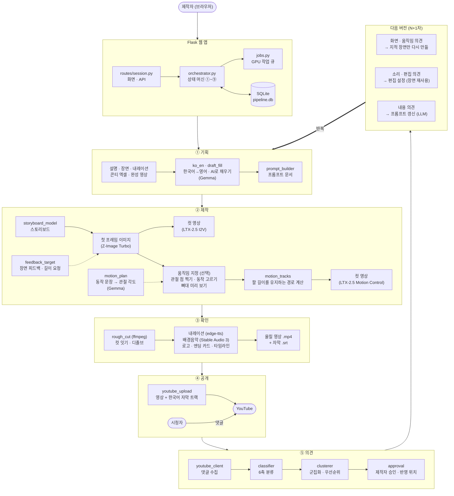

# AI 영상 피드백 자동 개선 시스템

> 사용자가 원하는 영상을 로컬 AI로 만들고, 시청자 댓글로 거듭 다듬는 파이프라인

제품 소개·홍보·뮤직비디오·단편 등 **만들고 싶은 영상을 한두 문장으로** 적으면, AI가 부족한 것만 되묻고
장면을 짠 뒤 로컬 영상 생성 AI(ComfyUI + LTX-2.5)로 장면 단위 영상을 만듭니다. **AI가 결과를 점검해 기준에 못 미치는 장면은
스스로 다시 만들고**, 사람은 완성된 영상 확인·공개와 반영할 의견 고르기만 합니다. 내레이션(TTS)·배경음악·로고를 얹어 YouTube에 올린 뒤, 시청자 댓글에서
**건설적인 피드백만 자동으로 골라 묶고**, 제작자가 승인한 의견을 다음 버전에 반영합니다.
지적받은 장면만 다시 만들고, 소리·편집 의견은 장면을 다시 만들지 않고 올릴 영상 합성에만 반영합니다.

**핵심 설계 원칙: 외부 계정 없이 동작한다.** 영상·이미지·음악 생성, 분류·임베딩, 번역, 음성 합성이 모두 로컬에서 실행되며,
Claude API와 YouTube 연동은 키·계정이 있을 때만 선택적으로 사용합니다.

### 프로젝트 배경

국립군산대학교 임베디드소프트웨어학과 캡스톤 디자인 프로젝트입니다. AI 영상은 한 번에 원하는 결과가 나오지 않아
"만들고 → 보여 주고 → 의견 듣고 → 고치는" 반복이 필수인데, 이 과정을 사람이 손으로 하면 댓글을 읽고 정리하고
프롬프트를 고치고 전체를 다시 만드는 데 많은 시간이 듭니다. 이 시스템은 그 반복을 자동화해 **지적받은 부분만** 다시 만듭니다.
시연 소재로 **학과 홍보영상**(회로 보드·로봇팔·자율주행 모형차)을 만들고 있습니다.

### 문서 안내

| 문서 | 내용 |
|------|------|
| `README.md` | 프로젝트 소개 (이 문서) |
| [`PROGRESS.md`](PROGRESS.md) | 진행 상황, 남은 일, 날짜별 실험·결정 기록 |
| [`CLAUDE.md`](CLAUDE.md) | 개발 규칙과 핵심 설계 (Claude Code 작업 지침) |
| [`VIDEO_PIPELINE_INTEGRATION.md`](VIDEO_PIPELINE_INTEGRATION.md) | 영상 파이프라인 통합 설계서 |
| [`promo_draft/README.md`](promo_draft/README.md) | 학과 홍보영상 초안 생성기 CLI |

---

## 목차

1. [전체 흐름](#1-전체-흐름)
2. [화면 구성](#2-화면-구성)
3. [주요 기능](#3-주요-기능)
4. [기술 스택과 모델](#4-기술-스택과-모델)
5. [설치와 실행](#5-설치와-실행)
6. [프로젝트 구조](#6-프로젝트-구조)
7. [파이프라인 상태 머신](#7-파이프라인-상태-머신)
8. [피드백 처리 알고리즘](#8-피드백-처리-알고리즘)
9. [영상 생성 파이프라인](#9-영상-생성-파이프라인)
10. [프롬프트 문서 형식](#10-프롬프트-문서-형식)
11. [폴백 체인](#11-폴백-체인)
12. [주요 설정](#12-주요-설정)
13. [오픈소스 vs 팀 직접 구현](#13-오픈소스-vs-팀-직접-구현)
14. [검증](#14-검증)
15. [시연용 데모 재생](#15-시연용-데모-재생)
16. [알려진 한계](#16-알려진-한계)

---

## 1. 전체 흐름

### 사람이 하는 일 — 처음 설명, 영상 확인·공개, 의견 고르기

1. 원하는 영상을 한두 문장으로 입력한다 (선택: 인물·물건·장소 참고 사진)
2. AI가 **부족한 정보만** 되묻는다. 나머지(길이·비율·내레이션·배경음악)는 기본값으로 채우고 "이렇게 가정했어요"로 보여 준다
3. AI가 프롬프트(스토리보드)를 만들고 장면별로 첫 프레임 이미지 → 컷 영상을 생성한다
4. AI가 결과를 점검하고 기준 미달 장면은 다시 만든다 (장면당 최대 2번, 그래도 미달이면 가장 나은 버전 + "확인 필요" 표시)
5. 완성된 영상을 사용자가 **한 번만** 확인한다 — 아쉬운 장면은 '직접 고치기' 도구로 그 장면만 다시
6. YouTube에 올리면 댓글을 1분마다 자동으로 모아 분류·묶기까지 하고, 제작자가 반영할 묶음을 정한다

단계마다 직접 확인하며 만들고 싶으면 첫 화면 메뉴의 **직접 기획하기**로 예전 흐름(기획 폼 → 이미지 확인 → 컷 확인 → 러프컷)을 쓸 수 있습니다.

```
 ┌────────────────┐   ┌───────────────────────┐   ┌──────────────────┐   ┌──────────────────┐
 │ ① 기획          │ → │ ② 제작                 │ → │ ③ 확인            │ → │ ④ 공개            │
 │ 설명·장면·내레이션│   │ 첫 프레임 이미지 → 확인 │   │ 러프컷 + 내레이션  │   │ YouTube 업로드    │
 │ (콘티 엑셀/완성  │   │ → (움직임 지정, 선택)  │   │ + 배경음악 + 로고  │   │ + 한국어 자막 트랙 │
 │  영상 불러오기)  │   │ → 컷 영상 → 확인       │   │ (타임라인 편집)    │   │                  │
 │                │   │ (Z-Image + LTX-2.5)   │   │                  │   │                  │
 └────────────────┘   └───────────────────────┘   └──────────────────┘   └────────┬─────────┘
         ▲                                                                          │
         │                                                                          ▼
 ┌───────┴─────────┐   ┌──────────────────┐   ┌──────────────────┐   ┌──────────────────┐
 │ 다음 버전(N+1차) │ ← │ 제작자 승인        │ ← │ 군집화·우선순위    │ ← │ ⑤ 의견            │
 │ 지적 장면만 재생성│   │ (반영 위치 지정)   │   │                  │   │ 댓글 수집·6축 분류 │
 │ 편집·소리는 재합성│   └──────────────────┘   └──────────────────┘   └──────────────────┘
 └─────────────────┘
```

### 시스템 블록도



- **프로젝트** = `PipelineSession` (화면 비율·장면 길이·로고·목소리)
- **버전(N차)** = `VideoRound` (프롬프트 문서·스토리보드 스냅샷·편집/음악 설정·상태)
- **장면 결과 1건** = `ShotRender` (이미지·컷 버전, 다시 만들면 새 버전이 쌓이고 고를 수 있음)

## 2. 화면 구성

| 화면 | 주소 | 내용 |
|------|------|------|
| 첫 화면 | `/` | 가운데 입력창에 만들고 싶은 영상을 적고 화면 비율·첨부(콘티 엑셀/완성 영상)를 고름 |
| AI에게 맡기기 | `/session/new` | AI의 질문(부족한 것만)·"이렇게 가정했어요"(눌러서 바꿈)·참고 사진 → 끝까지 자동 |
| 직접 기획하기 (① 기획) | `/session/create` | 제목·종류 추천, 장면 구성·내레이션·스타일 입력, **AI로 채우기**, 콘티 엑셀 불러오기 |
| 내 프로젝트 | `/projects` | 프로젝트 목록, `?view=todo` = 할 일(사람 확인이 필요한 단계) |
| 프로젝트 상세 | `/session/<id>` | 왼쪽 **단계 탭** ① 기획 ② 제작 ③ 확인 ④ 공개 ⑤ 의견 + 위쪽 상태 줄(진행률·생성 중지) |
| 의견 검토 | `/session/<id>/review` | 클러스터 승인·거절·보류, 반영 위치, 다음 버전 편집 설정 |
| 버전 기록·리포트 | `/session/<id>/versions`, `/report` | 프롬프트 diff·롤백, 반영률·절약 시간·재사용 장면 |
| 완성 영상 불러오기 | `/session/import` | 컷 경계 자동 감지 → 합치기/나누기 → 1차 버전으로 등록 |
| 점검 페이지 (개발용) | `/dev/pipeline-test` | 영상 생성~2차 부분 재생성까지 단계별 실행·자동 판정 |
| 대화형 시작 (데모 앱만) | `/demo` | 시연 촬영용: 설명·질문에 답하면 준비된 결과로 이어짐 ([15절](#15-시연용-데모-재생)) |

모든 버전이 같은 단계 탭을 쓰고, 지난 버전은 읽기 전용입니다. 진행 중에는 상태 줄이 2초마다 갱신됩니다.

## 3. 주요 기능

### AI 자동 진행
- **부족한 것만 묻기** (`intake.py`) — 영상 종류·길이·화면 비율·내레이션·배경음악은 설명에서 읽고, 못 읽으면 기본값으로 가정해 보여 줌.
  종류를 알 수 없을 때만 그것을 묻고, 내용 질문은 Gemma가 꼭 필요한 것만 최대 2개 (보기 + 직접 쓰기)
- **AI 기획** — 'AI로 채우기'와 '장면 다듬기'를 이어서 써 장면·내레이션·스타일을 만들고 영상 모델용 영어로 다듬음
- **AI 점검** (`auto_review.py`) — 첫 프레임은 Gemma4 26B 비전(못 쓰면 e2b)으로 묘사 일치 점수·글자·형태 깨짐을, 컷은 프레임 차이로
  멈춘 화면·어두운 화면·의도하지 않은 줌을 보고 뒤쪽 75%·끝 95% 프레임도 묘사 일치 점수로 봄. 미달이면 고쳐 쓰기 문장을 장면 의견으로 넣어
  그 장면만 다시 만들고(묘사와 다르면 첫 프레임부터), 장면마다 가장 나은 버전을 고름. AI가 답하지 못하면 통과로 두고 멈추지 않음
- **자동 움직임 경로** (`auto_motion.py`, `AUTO_MOTION`) — 컷을 만들기 전에 26B 비전이 첫 프레임에서 물체·집게 위치를 찾아
  옮기기·집어 올리기 경로를 자동으로 만들어 줌. 못 찾으면 경로 없이 진행
- **사진으로 영상 만들기** (`photo_scenes.py`) — 사진을 올리면 사진 하나가 장면 하나가 되고 그 사진을 그대로 움직인다(LTX I2V). 장면마다 일어날 일을 적거나 AI에게 맡김
- **참고 사진** (`ref_photos.py`·`face.py`) — 인물·물건·장소 사진을 한 칸에서 받는다(이름·종류, 최대 6장). Gemma4 26B 비전이 사진마다
  생김새(머리 모양·안경·옷 / 모양·색·부품 / 방 분위기)를 영어로 읽어, 사람이 나오는 장면엔 인물 생김새를, 그 이름이 나오는 장면엔 물건·장소
  생김새를 장면 묘사에 글로 넣고 Z-Image로 그린다 — 사진을 그림에 넣거나 얼굴을 합성하지 않아 AI 느낌이 덜하다(2026-11-07~, `REF_PHOTO_MODE=reference`).
  예전 방식(Qwen-Image-Edit-2511로 사진대로 그리기)은 `REF_PHOTO_MODE=draw`
- **참조 영상으로 움직임 따라 하기** (`reference_video.py`) — 영상의 윤곽선을 따라 동작·구도는 그대로, 겉모습만 장면 묘사대로 (LTX Union Control IC-LoRA)
- **제작 원칙 질문** (`intake.rule_questions`, `plan_rules.py`) — 정해 둔 규칙 대신 AI가 설명을 보고 '꼭 지킬 조건' 질문을 만들고, 답한 것만 그 프로젝트의 원칙으로 AI 기획이 따름. 화면 글자 금지는 항상 적용
- **배경음악 파일 올리기** — 맡기기 화면이나 ③ 꾸미기에서 곡을 올리면 그 곡을 쓰고, 없을 때만 AI(Stable Audio 3 Medium)가 만듦
- **글자 없는 화면** (`text_free.py`) — 글자·로고는 편집에서 넣고, 모델에는 모니터·간판을 글자 없는 모습으로 묘사
- **한 번 확인** — ③ 확인 화면에 장면별 점검 결과, 끝까지 미달인 장면, AI가 가정한 것을 보여 줌.
  미달 장면을 눈으로 보고 괜찮으면 **'문제없음으로 확인'**(`/api/shots/<id>/confirm`) → '사람이 확인 · 문제없음'으로 표시, 취소 가능

### 기획 (직접 기획하기)
- **텍스트로 새 영상 만들기** — 영상 설명·장면 목록·내레이션·스타일을 입력. **한국어로 적어도 된다**:
  저장할 때 장면·스타일 줄만 영어로 바꿔 영상 모델에 주고(`ko_en.py`), 화면에는 적은 한국어 그대로 보여 줌.
  번역에 실패하면 만들지 않고 안내(한국어를 몰래 모델에 넣지 않음)
- **AI로 채우기** (`draft_fill.py`) — 비어 있는 칸만 한국어 초안(제목·종류·등장 요소·장면·내레이션·스타일)으로 채움.
  설명의 'N초'로 장면 수를 정하고, 적어 둔 칸은 덮어쓰지 않음
- **콘티 엑셀(.xlsx) 불러오기** — `장면 ID`·`길이(초)`·`내레이션`·`장면 동작 (영문)`·`시드` 등 머리글 이름으로 콘티를 읽어 폼을 채움
- **완성 영상 불러오기** — 이미 만든 영상(+선택 .srt)을 올리면 컷 경계를 자동으로 찾아 제안(디졸브·페이드도 감지,
  하드 컷은 프레임 단위). 각 장면의 영어 묘사는 Gemma가 장면 가운데 프레임을 보고 작성
- **장면 다듬기** (`scene_refine.py`) — 적어 둔 장면 줄을 이미지·영상 모델이 잘 따르는 영어 한 줄로 고쳐 씀
  (분위기·장소 먼저, 보이는 것만, 카메라 움직임은 끝에). 고치기 전·후를 보여 주고 받아들일 때만 바꿈.
  큰 모델(Gemma4 26B, llama-server)을 필요할 때만 켜고 끄며, 영상 작업 중이면 e2b로 대신함
- **제작 중에도 기획 고치기** — 장면을 (묘사, 길이)로 짝지어 고친·새 장면만 다시 만들고, 저장 전에 다시 만들 장면을 미리 보여 줌

### 제작 (② 장면별 영상)
- **단계별 확인 생성** — 첫 프레임 이미지 확인(피드백 문장과 함께 "다시 뽑기") → 컷 영상 확인("다시 만들기") → 사람이 눌러야 러프컷
- **장면별 피드백** — "더 밝게", "카메라 기준 오른쪽으로 코너 돌게" 같은 문장을 장면 묘사 자체를 고친 영어 프롬프트로 바꿔 다시 만듦.
  **길이 요청**("3초로", "2초 더", "두 배", "늘려줘", "나레이션이 빨라")은 장면 길이를 바꾸고, 얼마나를 말하지 않으면
  **내레이션이 1배속으로 들어가는 길이**를 재서 맞춤(앞뒤 잘라 냄·디졸브 겹침·말 시작 지연 포함)
- **이 순간을 끝으로 다시 만들기** — 컷에서 고른 순간을 마지막 프레임으로 고정해 같은 길이로 다시 만듦
  (LTX-2.5 FLF2V). 요청한 동작 뒤에 엉뚱한 동작이 붙을 때 씀
- **움직임 지정** — 첫 프레임에 로봇팔 관절·물체를 차례로 찍고 동작("관절 접기", "집어 올리기")을 고르면 경로를 계산해
  그 경로대로 컷을 만듦 (LTX Motion Control IC-LoRA). 생성 전에 뼈대 미리 보기로 확인하고, 시드를 바꿔 컷을 1~4개 뽑아 고를 수 있음.
  순기구학·역기구학으로 계산해 팔 길이가 유지되고, 물체가 집게보다 크거나 팔이 닿지 않으면 생성 전에 안내함
  **문장으로도 지정** — "팔을 들고 손목을 흔들어"처럼 적으면 로컬 Gemma가 관절 각도 계획으로 바꿔 채워 주고, 단계별 각도를 직접 고칠 수도 있음. 관절 위치는 사람이 찍음
- **의견 관리** — 무엇으로 바꿀지 없는 모호한 의견은 방향을 먼저 묻고, 지난 장면 의견은 지울 수 있음
- **생성 중지·재시도** — 대기 작업은 취소, 실행 중 장면은 ComfyUI `/interrupt`. 만들어진 장면은 남고 실패한 장면만 다시

### 확인 (③ 올릴 영상)
- **러프컷 합성** — 선택된 컷을 정규화해 디졸브(기본 0.4초)로 잇고, AI 컷의 시작 멈칫·끝 느려짐을 조금 잘라 냄
- **내레이션** — 장면별 한국어 해설을 TTS로 합성해 장면 길이에 맞춤(최대 1.4배속, 그래도 넘치면 안내).
  프로젝트마다 목소리 선택·미리 듣기, 이 버전의 크기·빠르기. 해설만 고치면 음성만 다시 합성
- **배경음악** — 영상 전체에 연주곡 한 곡(Stable Audio 3 Medium, 로컬. `MUSIC_ENGINE=minimax`면 MiniMax Music 3 — 다른 소리가 섞여 기본에서 뺌, 2026-11-05). 곡 설명은 Gemma가 제안하고 고칠 수 있음(영어가 잘 따름).
  곡을 60초 이상으로 만들어 **소리 크기가 가장 고른 구간**을 골라 씀(짧게 만들면 도입·끝맺음이 욱여넣어져 출렁였다).
  내레이션이 나오면 자동으로 작아지고, 다음 버전에도 같은 곡이 이어짐("분위기가 안 맞아요" 같은 의견일 때만 바뀜)
- **로고** — PNG·JPG·WEBP 또는 Illustrator `.ai`(PDF 호환)·`.pdf`(투명 PNG로 변환). 올릴 영상 화면(엔딩 카드 등) 위 미리보기에서
  **누르거나 끌어서 위치 지정**(저장 전 벡터 파일도), 크기·불투명도, 보이는 때(전체/처음 N초/끝 N초/타임라인 구간)
- **타임라인** — 올릴 영상 아래에 장면·자막·로고 막대를 영상 시각에 맞춰 그림. 막대를 끌어 옮기거나 양 끝을 끌어
  자막·로고가 나오는 때를 정하고, 영상 재생 위치와 함께 움직임
- **자막은 YouTube 자막으로** — 영상에 굽지 않고 내레이션 시각에 맞춘 `.srt`를 만들어 업로드 때 한국어 자막 트랙으로 올림.
  직접 올릴 때를 위해 `.srt` 내려받기 제공
- **엔딩 카드** — 마지막 장면을 검게 사라지게 한 뒤 배경색 + 로고 + 학과명 카드로 끝냄(`rough_cut._end_card_clip`).
  페이드아웃은 편집 효과라 AI 프롬프트에서 뺌(`camera.strip_fades`) — AI에게 시키면 장면 안 조명이 꺼지는 장면이 됐다
- **장면 소리 끄기** — 영상 모델이 만든 효과음을 빼고 내레이션·배경음악만

### 공개·의견 (④·⑤)
- **YouTube 업로드** — Google 계정 연결(OAuth PKCE) 후 제작자가 눌러야만 업로드(이어 올리기, 공개 범위, AI 생성 표시) + 자막 트랙.
  연결 없이 직접 올린 영상 ID를 이어 줄 수도 있음
- **공개 취소** — 댓글을 모으기 전이면 ③ 확인으로 되돌려 올릴 영상만 고쳐 다시 올림(장면은 그대로, 예전 영상은 지우지 않음)
- **댓글 수집** — YouTube Data API 또는 시뮬레이션, 화면에서 직접 입력·장면별 의견도 가능.
  공개 뒤에는 화면이 1분마다 새 댓글을 자동으로 모으고(`auto-collect`), 댓글이 들어오면 분류 → 묶기까지 자동으로 처리
- **6축 분류** — 구체성·타당성·심각도·긴급도·품질·멀티레이블 토픽, 댓글 속 `1:23` 같은 시각 → 장면 매핑
- **2단계 군집화** — 토픽별 그룹 → 그룹 내 HDBSCAN / 계층적 군집화, **5축 우선순위** + 재발 이슈 부스트 + 상반 의견 감지
- **승인 워크플로** — 묶음별로 반영 여부를 정함. 반대 의견이 없는 묶음은 '반영'으로 미리 골라 두고 반대 의견이 있는 묶음만 '결정 전'으로 남김.
  반영 위치(화면·움직임·편집·소리·내용)를 확인한 뒤 '반영하고 다음 버전 만들기'
- **다음 버전** — 화면·움직임 의견이 지적한 장면만 다시 만들고 나머지는 재사용. 소리·편집 의견은 **편집 설정**
  (전환·소리 크기·빠르기·장면 길이·속도·순서·자막·배경음악)으로만 반영. 내용 의견은 LLM이 [영상 설명]·[내레이션]만 다시 씀
- **프롬프트 버전 관리·리포트** — 버전별 diff, 롤백, 반영률·수동 처리 대비 절약 시간·재사용 장면 수

## 4. 기술 스택과 모델

| 영역 | 사용 기술 |
|------|-----------|
| 백엔드 | Python 3.11, Flask 3.x, SQLAlchemy (SQLite) |
| ML | sentence-transformers, scikit-learn, hdbscan, transformers |
| 영상·이미지·음악·글 | ComfyUI (LTX-2.5, Z-Image Turbo, Gemma, Stable Audio 3 Medium), ffmpeg |
| 음성 | edge-tts, Supertonic-3, Windows SAPI |
| UI | Bootstrap 5, Chart.js |

| 역할 | 모델 | 라이선스 | 실행 위치 |
|------|------|---------|-----------|
| 피드백 분류 (기본) | `paraphrase-multilingual-MiniLM-L12-v2` | Apache 2.0 | CPU |
| 클러스터링 임베딩 | `paraphrase-multilingual-mpnet-base-v2` | Apache 2.0 | CPU |
| 분류 폴백 (NLI) | `MoritzLaurer/mDeBERTa-v3-base-zeroshot-v2.0` | MIT (게이트됨) | CPU |
| 영상 생성 | LTX-2.5 (T2V / I2V, ComfyUI, GGUF Q4_K_M) | — | GPU |
| 첫 프레임 이미지 | Z-Image Turbo | — | GPU |
| 번역·화면용 글·큰 모델을 못 쓸 때 대신 | Gemma4 e2b (ComfyUI `TextGenerate`) | — | GPU |
| 기획(AI로 채우기·장면 다듬기)·맡기기 질문·AI 점검·참고 사진 읽기·자동 움직임 경로 | Gemma4 26B A4B (llama-server, 필요할 때만 켬) | — | GPU+CPU |
| 움직임 경로 / 참조 영상 따라 하기 | LTX IC-LoRA Motion Track Control / Union Control | — | GPU |
| 참고 사진대로 그리기 (`REF_PHOTO_MODE=draw`, 기본 아님) | Qwen-Image-Edit-2511 | — | GPU |
| 배경음악 | Stable Audio 3 Medium (기본) / MiniMax Music 3 (`MUSIC_ENGINE=minimax`) | Stability AI 라이선스 — YouTube 설명에 "Powered by Stability AI" 표기 / MiniMax-Music3 Community License | GPU |
| 내레이션 | edge-tts(기본, 인터넷 필요) → Supertonic-3(로컬 CPU) | — | CPU |
| 영상 생성 (`local` 어댑터) | `Wan-AI/Wan2.1-T2V-1.3B-Diffusers` | Apache 2.0 | GPU |

> 기준 GPU: RTX 5070 Ti 16GB. 영상 생성 중에는 GPU를 쓰는 다른 프로그램을 꺼야 합니다.
> ComfyUI 모델·설치 폴더는 이 저장소 밖에 있고, 워크플로 JSON·설정은 이름만 가리킵니다.

## 5. 설치와 실행

```powershell
# 가상환경 (Windows PowerShell, Python 3.11)
py -3.11 -m venv venv
.\venv\Scripts\pip install -r requirements.txt
.\venv\Scripts\pip install -r requirements-video.txt   # local(diffusers) 어댑터를 쓸 때만

# 내레이션 엔진 (edge-tts · Supertonic) — 별도 가상환경
py -3.11 -m venv venv_tts2
.\venv_tts2\Scripts\pip install edge-tts supertonic

# 설정
copy .env.example .env    # 값 채우기 (키가 없어도 동작)

# 앱 실행 → http://127.0.0.1:5000
.\venv\Scripts\python run.py
```

- 실제 영상·이미지·음악·번역에는 ComfyUI 서버(`COMFYUI_URL`, 기본 `http://127.0.0.1:8188`)가 필요합니다.
  꺼져 있으면 영상은 mock 어댑터로 대체되고 화면에 "mock으로 대체됨"이 표시됩니다.
- 움직임 지정에는 ComfyUI에 [ComfyUI-LTXVideo](https://github.com/Lightricks/ComfyUI-LTXVideo) 노드와
  [`ltx-2.3-22b-ic-lora-motion-track-control-ref0.5`](https://huggingface.co/Lightricks/LTX-2.3-22b-IC-LoRA-Motion-Track-Control) LoRA가 필요합니다.
  없으면 경로를 저장할 때 설치 안내가 나오고, 움직임 지정을 쓰지 않는 장면은 그대로 만들어집니다.
  노드의 패키지는 ComfyUI를 끈 뒤 설치하세요. 켠 채로 설치하면 파일 잠금 때문에 패키지가 깨질 수 있습니다.
- 러프컷·컷 감지는 ffmpeg를 씁니다(`FFMPEG_PATH` → PATH → imageio-ffmpeg 순으로 찾음).
- `run.py`는 자동 재시작이 없습니다. **코드를 고친 뒤에는 서버를 다시 켜야** 반영됩니다.

## 6. 프로젝트 구조

```
project_ai_feedback/
├─ app/
│  ├─ __init__.py              create_app(), 기존 테이블에 새 컬럼 추가(SQLite ALTER TABLE)
│  ├─ models.py                DB 모델
│  ├─ pipeline/
│  │  ├─ classifier/           6축 분류기 (임베딩 → NLI → 규칙 폴백), 타임스탬프 추출
│  │  ├─ clusterer/            임베딩, 토픽 태깅, 계층적 군집화, 우선순위
│  │  ├─ video_generator/      어댑터: comfyui / local / mock
│  │  │  └─ comfyui/           ComfyUI 클라이언트, 워크플로 주입, rough_cut.py(러프컷·내레이션 트랙·로고·음악·자막 .srt)
│  │  ├─ narration/            내레이션 TTS (edge/Supertonic 작업자, SAPI) + 장면 길이에 맞추기
│  │  ├─ orchestrator.py       상태 머신, 단계 계산, 생성 흐름, 부분 재생성, 기획 변경, 데모 재생
│  │  ├─ auto_pipeline.py      AI 자동 진행: 기획 → 이미지·점검 → 컷·점검 → 러프컷
│  │  ├─ intake.py auto_review.py face.py ref_photos.py   부족한 것만 묻기 / AI 점검 / 참고 사진(생김새 읽기)
│  │  ├─ auto_motion.py        자동 움직임 경로 (26B 비전으로 물체·집게 위치 찾기)
│  │  ├─ plan_rules.py text_free.py camera.py   제작 원칙 질문 / 글자 없는 화면 / 고정 카메라·페이드 빼기
│  │  ├─ photo_scenes.py reference_video.py tone.py   사진 → 장면 / 참조 영상 움직임 / Qwen 그림 색 낮추기
│  │  ├─ jobs.py               GPU 작업 큐 (워커 스레드 1개)
│  │  ├─ storyboard_model.py   스토리보드 스키마, 타임스탬프 → 장면 매핑
│  │  ├─ feedback_target.py    의견의 반영 위치, 길이 요청 읽기, 장면 묘사 고쳐 쓰기
│  │  ├─ edit_plan.py          편집 설정 + 의견 → 편집 제안
│  │  ├─ overlay.py            로고 합성, 자막 .srt, 로고 시각 계산
│  │  ├─ bgm.py music.py       배경음악 설정·곡 생성(ComfyUI)·고른 구간 고르기
│  │  ├─ voice.py              내레이션 목소리 (프로젝트 공통)
│  │  ├─ motion_tracks.py      움직임 경로: 로봇팔 프리셋 계산(순·역기구학), 저장 형식, 생성 해상도로 변환
│  │  ├─ motion_plan.py        동작 문장 → 관절 각도 계획 (LLM, 검사 포함)
│  │  ├─ ko_en.py draft_fill.py scene_refine.py   한국어 입력 → 영어, AI로 채우기, 장면 다듬기
│  │  ├─ comfy_text.py translate.py translate_worker.py   Gemma 글 생성(이미지 입력), 화면용 영→한 번역 캐시
│  │  ├─ storyboard_import.py video_import.py   콘티 엑셀 / 완성 영상 불러오기
│  │  ├─ approval.py           클러스터 저장·승인 적용·롤백·재발 추적
│  │  ├─ prompt_builder.py prompt_updater.py   프롬프트 문서 구성·파싱 / 다음 버전 프롬프트
│  │  ├─ llm.py                Claude → Ollama → ComfyUI Gemma → 템플릿
│  │  ├─ youtube_client.py youtube_upload.py   댓글 수집 / 업로드·자막(OAuth + 이어 올리기)
│  │  └─ metrics.py            반영률·시간 절약 지표
│  ├─ routes/                  session.py(화면·API), devtest.py(점검 페이지), demo.py(데모 앱 대화형 시작)
│  ├─ templates/               home, index, _app_shell, session/{detail, create, import, _plan_form, _scene_viewer, _timeline, review, …}
│  └─ static/                  css/style.css, js/round_view.js(상태 줄), devtest.js·pipeline_stepper.js(점검 페이지)
├─ tests/                      fake_comfyui.py, video_checks.py, custom_video_checks.py, auto_checks.py (run_check.py가 호출)
├─ promo_draft/                학과 홍보영상 초안 CLI (run.py + storyboard_*.yaml, 결과는 outputs/)
│  └─ workflows/               ComfyUI Export(API) 워크플로 JSON + mapping.yaml — 앱도 여기서 읽음
│                              (ltx25_t2v · ltx25_i2v · ltx25_flf2v · ltx25_motion · ltx25_union · zimage_t2i · qwen_face_t2i)
├─ instance/                   pipeline.db, 영상·로고·토큰 (git 제외)
├─ instance_demo/              데모 앱 전용 작업 폴더 (git 제외)
├─ docs/                       feedback_loop.html (피드백 루프 설명 그림), project_intro.html (프로젝트 소개 한 장)
├─ _archive/                   쓰지 않는 예전 파일 보관 (git 제외, 지워도 동작에 영향 없음)
├─ config.py                   모든 설정 (.env 우선)
├─ run.py                      앱 실행
├─ run_check.py                전체 검증
├─ run_cluster.py              수동 분류·군집화
├─ run_demo.py                 시연용 데모 앱 실행 (5001번, instance_demo)
├─ demo_setup.py               실제 DB에서 데모 프로젝트 복사
├─ demo_reset.py               데모 프로젝트를 처음으로 되돌림
├─ requirements.txt            기본 의존성 (CPU만으로 동작)
├─ requirements-video.txt      local(diffusers) 어댑터용 GPU 의존성
├─ CLAUDE.md                   개발 규칙·핵심 설계 (Claude Code 지침)
├─ PROGRESS.md                 진행 상황·남은 일·실험 기록
└─ VIDEO_PIPELINE_INTEGRATION.md   영상 파이프라인 통합 설계서
```

가상환경: `venv`(앱), `venv_tts2`(edge-tts·Supertonic).

### 주요 DB 테이블

| 테이블 | 역할 |
|--------|------|
| `PipelineSession` | 프로젝트 (화면 비율·장면 길이·로고 `brand_json`·목소리 `voice_json`·데모 `demo_json`) |
| `VideoRound` | 버전(N차): 상태·프롬프트·스토리보드 스냅샷·편집/음악/내레이션 설정·타임라인·YouTube ID |
| `ShotRender` | 장면 결과 1건 (버전·상태·시드·이미지/영상 경로·비용·재사용 원본·선택 여부) |
| `GenerationJob` | GPU 작업 큐 |
| `Feedback` | 댓글 + 6축 점수 + 타임스탬프 |
| `ClusterResult` | 클러스터 (우선순위·응집도·요약·지적 장면·반영 위치·승인 상태) |
| `PromptVersion` / `PromptChange` | 프롬프트 버전과 diff |
| `GlobalTechnicalSetting` | 전역 기술 설정으로 승격된 의견 |
| `Metric` | 반영률·재사용 장면 지표 |
| `TextTranslation` | 번역 캐시 (영어 장면 묘사 ↔ 한국어, 사용자가 쓴 한국어 원문 포함) |

## 7. 파이프라인 상태 머신

```
① prompt_built          프롬프트(스토리보드) 생성/갱신 완료
② generating            GPU 작업 큐에서 생성 중 (진행률 n/N)
     ├ images_ready     첫 프레임 이미지 확인 대기   ┐ 단계별 확인 생성
     ├ clips_ready      컷 영상 확인 대기            ┘ (COMFYUI_STAGED_REVIEW)
     └ generation_failed  실패 장면만 재시도
③ video_ready           올릴 영상(러프컷) 완료, 사람 확인 대기
④ uploaded              공개 (댓글 수집 전이면 ③으로 되돌릴 수 있음)
⑤ feedback_collected    댓글 수집 완료
⑥ feedback_classified   6축 분류 + 타임스탬프 추출
⑦ clustering            군집화 진행 중 (비동기)
⑧ pending_review        제작자 승인 대기
⑨ prompt_updated        승인 적용 → 다음 버전 ① 생성
```

- 상태 전이는 `orchestrator.advance(round, to_state)` **한 곳에서만** 수행하며, 허용되지 않은 전이는 `InvalidTransition`.
- 같은 단계의 반복(댓글 추가·재분류·재군집화)은 자기 자신으로의 전이로 허용.
- 화면의 단계 탭: ② 제작 = 장면별 영상(이미지 → 컷), ③ 확인 = 올릴 영상 합성·확인. 러프컷 합성 중에는 ③에 진행을 표시.
- 상태 API `GET /api/rounds/<id>/status`, 제어 API `POST /api/rounds/<id>/{retry,advance,approve-video,cancel,rough-cut,replan,auto-collect}`.

## 8. 피드백 처리 알고리즘

### 6축 분류 (`EmbeddingClassifier`)
원형(prototype) 문장과의 코사인 유사도로 건설적/비건설적을 판별하고, 정규식 신호로 점수를 매깁니다.

| 축 | 방식 |
|----|------|
| 구체성 (specificity) | 정규식 신호 + 임베딩 |
| 타당성 (validity) | 정규식 신호 |
| 심각도 (severity) | 정규식 신호 |
| 긴급도 (urgency) | 정규식 신호 |
| 품질 (quality) | 위 점수 종합 |
| 토픽 | 멀티레이블, 댓글 하나에 최대 3개 카테고리 |

승인된 피드백으로 원형을 지수이동평균 갱신하는 **온라인 학습**(`update_prototype()`)을 지원합니다.

### 2단계 군집화
1. **토픽 태깅** — `topic_category` 기준으로 그룹화
2. **그룹 내 군집화** — 댓글 12개 이상이면 HDBSCAN, 미만이면 AgglomerativeClustering (cosine, average)

카테고리별 적응형 거리 임계값:

| technical | subtitle | story | visual | audio | pacing | content |
|-----------|----------|-------|--------|-------|--------|---------|
| 0.26 | 0.30 | 0.34 | 0.36 | 0.38 | 0.42 | 0.44 |

- 임베딩 대상은 요약문이 아니라 **댓글 원문**(교차 언어 품질 유지)
- 15개 초과 클러스터는 자동 서브클러스터링
- 대표 텍스트 = 중심 근접도 50% + 품질 30% + 길이 20%
- 응집도 점수(쌍별 코사인 유사도 평균), 단어 빈도 기반 요약 문장

### 5축 우선순위
```
P = 0.35·빈도 + 0.25·품질 + 0.20·심각도 + 0.12·긴급도 + 0.08·타당성
재발 부스트:  × (1 + 0.10 × min(이전 등장 횟수, 3))
상반 페널티:  × 0.60   (상반된 의견이 함께 있을 때)
```

### 반영 위치 (`feedback_target.py`)
| 위치 | 의미 | 장면 처리 |
|------|------|-----------|
| `scene` 화면 | 구도·대상·색감 | 첫 프레임 이미지부터 다시 (시드 변경) |
| `motion` 움직임 | 카메라·동작 | 이전 첫 프레임 유지, 컷만 다시 |
| `edit` 편집 | 전환·속도·순서·자막 | 재사용 → 편집 설정으로 올릴 영상만 다시 합성 |
| `audio` 소리 | 음악·음성·내레이션 | 재사용 → 편집 설정으로 올릴 영상만 다시 합성 |
| `content` 내용 | 설명 부족·장면 추가 | 재사용 → [시청자 반영 사항], LLM이 [영상 설명]·[내레이션] 다듬기 |

키워드 + 카테고리로 자동 제안되고 검토 화면에서 바꿀 수 있습니다.
지적된 장면은 한국어 의견을 **장면 묘사 자체를 고친 영어 문장**(`prompt_fixed`)으로 바꿔 원래 묘사 대신 씁니다
(고친 상태만 묘사하고 실수는 묘사하지 않음). 한국어 원문은 이미지 모델이 화면에 글자로 그려 버리므로 절대 넣지 않습니다.

## 9. 영상 생성 파이프라인

### 어댑터

| 어댑터 | 설명 |
|--------|------|
| `comfyui` | 로컬 ComfyUI + LTX-2.5, 장면 단위 생성 (기본) |
| `local` | diffusers Wan 2.x, 전체를 한 번에 생성 |
| `mock` | 스토리보드만, 영상 파일 없음 (폴백·시험용) |

### 장면 생성 과정 (이미지 먼저 + 단계별 확인)
1. Z-Image Turbo로 장면 첫 프레임 이미지 생성 → 사람이 확인, 필요하면 피드백 문장과 함께 "다시 뽑기"(시드 +101)
2. 승인된 이미지를 LTX-2.5 I2V로 움직여 컷 생성 → 확인, "다시 만들기"(이전 컷은 버전으로 남아 고를 수 있음).
   움직임 경로를 지정한 장면만 `ltx25_motion` 워크플로로 만듦. 경로는 그린 첫 프레임에 묶여 있어, 첫 프레임을 다시 뽑으면 적용되지 않고 화면에 표시됨
3. "다음: 확인 단계로"를 누르면 선택된 컷을 정규화·다듬어 디졸브로 잇고, 내레이션·배경음악·로고를 얹고 자막 `.srt`를 만듦

### 설계 결정
- **프롬프트 문서가 원본, 스토리보드는 파생 스냅샷** — 생성 시점에 장면 JSON을 만들어 `VideoRound.storyboard_json`에 저장
- **부분 재생성** — 이전 버전과 프롬프트·스타일·길이·해상도가 같고 지적되지 않은 장면은 파일을 재사용
- **지적 장면 계산** — 댓글 타임스탬프 → 장면. 없으면 technical/subtitle/audio는 전 장면, 그 외는 LLM 추정
- **편집 설정은 장면 서명에 들어가지 않음** — 소리·편집·자막·로고·음악을 바꿔도 장면은 다시 만들지 않고 올릴 영상만 다시 합성
- **타임라인 = 실제 합성 값** — 러프컷을 만들 때 쓴 장면·자막·로고 시각을 `VideoRound.timeline_json`에 남겨 그대로 그림
- **작업 큐** — 워커 스레드는 첫 작업 때 지연 시작, 재시작 시 실행 중이던 작업은 재시도 가능 상태로 복구

산출물: `instance/videos/session_<id>/round_<n>/<shot_id>/v<k>.mp4` (+ 첫 프레임 `v<k>.png`),
올릴 영상 `round_<n>/rough_cut.mp4`, 자막 `round_<n>/subtitles.srt`, 배경음악 `round_<n>/bgm_*.flac`

## 10. 프롬프트 문서 형식

`[섹션명]` 헤더로 나뉜 텍스트이며 버전 관리·diff 대상입니다.

```
[프로젝트]        [영상 종류]       [버전]          [등장 요소]
[이전 버전 요약]  [영상 설명]       [샷 목록]       [내레이션]
[영상 스타일]     [시청자 반영 사항] [연출 지침]
```

- 영상 모델에는 **[샷 목록]의 각 줄(영어) + [영상 스타일]만** 전달 (샷 1개 = 클립 1개)
- 샷 줄 앞에 `[6초]`, `[6초 시드 202]`를 쓰면 그 샷만 길이·시드 지정 (모델에는 전달되지 않음)
- [내레이션]은 샷 번호와 1:1인 한국어 해설 — 장면 서명에 포함되지 않아 해설만 고치면 음성만 다시 합성
- 다음 버전에서도 [영상 설명]·[샷 목록]은 유지되고, 승인된 의견은 [시청자 반영 사항]·[연출 지침]으로 들어감
- 로고·글자는 절대 영상 모델 프롬프트에 넣지 않음 (로고는 합성, 자막은 YouTube 자막 트랙)

## 11. 폴백 체인

```
피드백 분류   EmbeddingClassifier → ZeroShotClassifier(NLI) → RuleBasedClassifier
군집화        HDBSCAN → AgglomerativeClustering
임베딩        mpnet-base-v2 → MiniLM-L12-v2 → TF-IDF
영상 생성     comfyui(LTX-2.5) → mock
글 다듬기     Claude API → Ollama(로컬) → ComfyUI Gemma(로컬) → 템플릿
기획·AI 점검 Gemma4 26B(llama-server) → Gemma4 e2b(ComfyUI)
번역          ComfyUI Gemma → llm.py → 영어만 표시
내레이션      edge-tts → Supertonic-3 (VOICE_ADAPTER / VOICE_FALLBACK)
배경음악      Stable Audio 3 Medium (ComfyUI) → 음악 없이 합성하고 사유 표시
댓글          YouTube Data API / 시뮬레이션 / 화면 직접 입력
```

## 12. 주요 설정

모델명·임계값·경로는 코드에 하드코딩하지 않고 모두 `config.py` + `.env`로 주입합니다. 전체 목록은 `config.py`와 `.env.example` 참고.

| 변수 | 기본값 | 설명 |
|------|--------|------|
| `VIDEO_GENERATOR_ADAPTER` | `comfyui` | `comfyui` / `local` / `mock` |
| `AUTO_REVIEW_MAX_RETRIES` / `AUTO_REVIEW_MIN_SCORE` | `2` / `6` | AI 점검: 장면당 다시 만드는 최대 횟수 / 묘사 일치 통과 점수(0~10) |
| `REF_PHOTO_MODE` | `reference` | 참고 사진 쓰는 방식: `reference`(생김새를 읽어 장면 묘사에 넣음, Qwen 안 씀) / `draw`(예전: Qwen으로 사진대로 그림) |
| `COMFYUI_URL` | `http://127.0.0.1:8188` | ComfyUI 서버 |
| `COMFYUI_IMAGE_FIRST` | `false` | 첫 프레임 이미지 먼저 생성 후 I2V (권장 `true`) |
| `COMFYUI_STAGED_REVIEW` | `false` | 이미지 → 컷 → 러프컷 단계별 확인 (권장 `true`) |
| `COMFYUI_WORKFLOW_MOTION` | `ltx25_motion` | 움직임 경로가 있는 장면에 쓰는 워크플로 |
| `AUTO_MOTION` | `true` | 자동 진행에서 움직임 경로를 26B 비전으로 자동 계산 |
| `STORYBOARD_SHOT_SECONDS` / `WIDTH` / `HEIGHT` / `FPS` | `5` / `576` / `960` / `24` | 장면 기본값 (프로젝트의 화면 비율에 맞게 배치) |
| `SHOT_MAX_SECONDS` | `8` | 의견으로 장면을 늘릴 때 최대 길이 |
| `CLIP_TRIM_HEAD_SEC` / `CLIP_TRIM_TAIL_SEC` | `0.15` / `0.1` | 러프컷에서 AI 컷 앞뒤를 잘라 내는 길이 |
| `VOICE_ADAPTER` / `VOICE_FALLBACK` | `edge` / `supertonic` | 내레이션 TTS 엔진 / 실패 시 대신 쓸 엔진 |
| `NARRATION_MAX_SPEEDUP` | `1.4` | 장면보다 긴 문장을 이만큼까지 빠르게 |
| `BGM_AUTO` / `MUSIC_MIN_SECONDS` | `true` / `60` | 배경음악 자동 / 곡을 이 길이 이상으로 만들어 고른 구간을 씀 |
| `TRANSLATE_ENABLED` | `true` | 장면 묘사 한국어 번역 표시 |
| `REFINE_LLAMA_SERVER` / `REFINE_LLAMA_MODEL` | (비움) | 큰 모델(기획·맡기기 질문·AI 점검) 서버·모델 파일. 비우면 Gemma4 e2b로 |
| `SIMULATION_MODE` | `true` | 댓글 시뮬레이션 (`false`면 YouTube Data API) |
| `REQUIRE_VIDEO_APPROVAL` | `true` | 업로드 전 사람 확인 |
| `ANTHROPIC_API_KEY` / `YOUTUBE_API_KEY` | (없어도 동작) | 선택 기능용 키 |
| `YOUTUBE_CLIENT_SECRETS` / `YOUTUBE_PRIVACY` | (없어도 동작) / `private` | 업로드용 OAuth 클라이언트 JSON 경로 / 공개 범위 기본값 |
| `DEMO_REPLAY_SEC_PER_SHOT` | `1.5` | 데모 재생에서 장면마다 '만드는 중'을 보여 주는 시간 |

> `.env`·API 키·`instance/youtube_token.json`은 절대 커밋하지 않습니다.

## 13. 오픈소스 vs 팀 직접 구현

| 오픈소스 활용 | 팀 직접 설계·구현 |
|---------------|-------------------|
| `SentenceTransformer` 문장 임베딩 | prototype 기반 다국어 분류기, 6축 판단 로직 |
| `AgglomerativeClustering` 계층적 군집화 | 동적 프로토타입 업데이트(온라인 학습) |
| `HDBSCAN` 밀도 기반 군집화 | 멀티레이블 토픽 태깅, 2단계 클러스터링 |
| `transformers` zero-shot NLI | 카테고리별 적응형 임계값, 대형 클러스터 서브클러스터링 |
| `difflib.unified_diff` 프롬프트 diff | 품질 가중 대표 텍스트, 응집도 점수, 추출 요약 |
| ComfyUI · LTX-2.5 · Z-Image · Gemma · Stable Audio · llama.cpp | 5축 우선순위 + 재발 부스트 + 상반 의견 감지 |
| ffmpeg (xfade·overlay·sidechaincompress) | 상태 머신·작업 큐·부분 재생성·반영 위치 판단·편집 설정 |
| edge-tts · Supertonic | 내레이션 길이 맞추기, 의견 → 장면 길이, 배경음악 고른 구간 고르기 |
| pypdfium2 · Pillow | 완성 영상 컷 감지, 콘티 엑셀 불러오기, 타임라인, YouTube 자막 업로드 |

## 14. 검증

```powershell
.\venv\Scripts\python run_check.py
```

- pytest가 아니라 **`run_check.py` 하나가 전체 검증**입니다. 임시 DB + 작업 큐 동기 실행 + mock 어댑터 + 시뮬레이션으로
  2차 버전까지 돌리고, 가짜 ComfyUI(`tests/fake_comfyui.py`)·가짜 Google 서버로 영상·업로드 흐름을 확인합니다.
  실제 ffmpeg로 러프컷·로고·자막·배경음악을 합성해 픽셀·소리 크기까지 봅니다. 약 390개 항목, 몇 분 걸립니다.
- 끝에 "모든 검증 통과" 또는 "실패 N건: …"(종료 코드 1)을 출력합니다. 실제 `instance/pipeline.db`는 건드리지 않습니다.
- `/dev/pipeline-test` — `[TEST]` 세션을 만들어 영상 생성부터 2차 부분 재생성까지 단계별로 실행하고 기대 동작을 자동 판정.

## 15. 시연용 데모 재생

시연 영상을 찍을 때 장면 생성(GPU로 수십 분)과 업로드를 기다리지 않도록, 프로젝트에 **준비된 결과**를 지정할 수 있습니다
(`PipelineSession.demo_json`). 그 차수에서 '제작 시작'을 누르면 "장면 n/N 만드는 중"을 몇 초 보여 준 뒤 준비된 버전의
장면·올릴 영상·자막·소리 설정을 그대로 쓰고, 'YouTube에 올리기'는 이미 올려 둔 영상(실제 댓글이 달린)에 연결합니다.
댓글 수집·분류·군집화·승인·반영은 실제로 처리합니다.

```powershell
.\venv\Scripts\python demo_setup.py      # 실제 DB에서 데모 프로젝트·영상을 데모 앱 폴더로 복사
.\venv\Scripts\python demo_reset.py      # 데모 프로젝트를 ① 기획 단계로 되돌림 (리허설 뒤)
.\venv\Scripts\python run_demo.py        # 데모 앱 → http://127.0.0.1:5001
```

- **데모 앱은 실제 앱과 분리**됩니다 — `run_demo.py`가 `DEMO_MODE=true`와 따로 된 작업 폴더 `instance_demo`(DB·영상·토큰·분류기)로 띄웁니다.
- 데모 앱의 `/`는 대화형 시작 화면 `/demo`로 이어집니다. 설명을 적고 준비된 질문에 답하면 'AI 기획 중'을 보여 준 뒤 준비된 결과로 이어집니다.
- 분류기는 승인 때 학습하므로 `demo_reset.py`가 분류기 파일도 기준 상태로 되돌립니다. 리허설은 데모 앱을 새로 켠 뒤에 합니다.
- 촬영 순서는 `D:\capstone\demo_kit\촬영_순서.md`에 있습니다.

## 16. 알려진 한계

- AI 점검은 비전 모델(Gemma4 26B, 못 쓰면 e2b)이 판단해 틀릴 수 있음 — 앞뒤로 겹쳐 보이는 물체나 동작이 끝난 프레임을 미달로 오판하기도 함.
  그래서 마지막 사람 확인('문제없음으로 확인')은 남겨 둠. 모델이 답하지 못하면 '점검 못 함'으로 표시
- 참고 사진은 생김새를 글로 옮겨 그리므로 얼굴·물건이 사진과 똑같지는 않다(장면마다 같은 사람·물건처럼 보이게 하는 것이 목적).
- 장면 간 인물·대상 일관성은 샷 묘사에 외모를 반복해 적는 것에 의존
- 배경음악은 모델이 곡 구조를 정하므로 고른 구간을 골라도 작아지는 곳이 남을 수 있음 — "다른 곡으로 바꾸기"로 다시 뽑음
- Google 감사를 받지 않은 프로젝트로 올린 영상은 YouTube가 비공개로 고정할 수 있음. 자막 업로드에는 `youtube.force-ssl` 권한이 필요해
  그 전에 연결한 계정은 다시 연결해야 함
- 움직임 지정은 2D 계산이라 옆에서 본 로봇팔에 맞음 (카메라 쪽으로 뻗는 팔은 어긋남). 집어 올리기는 시드에 따라 물체가 따라오지 않을 수 있어
  여러 컷을 뽑아 고르며, 관절 형태 변화와 미세한 끊김은 모델 쪽 한계로 남음
- 컬럼 제거·타입 변경 시에는 `instance/pipeline.db`를 삭제하고 다시 만들어야 함
